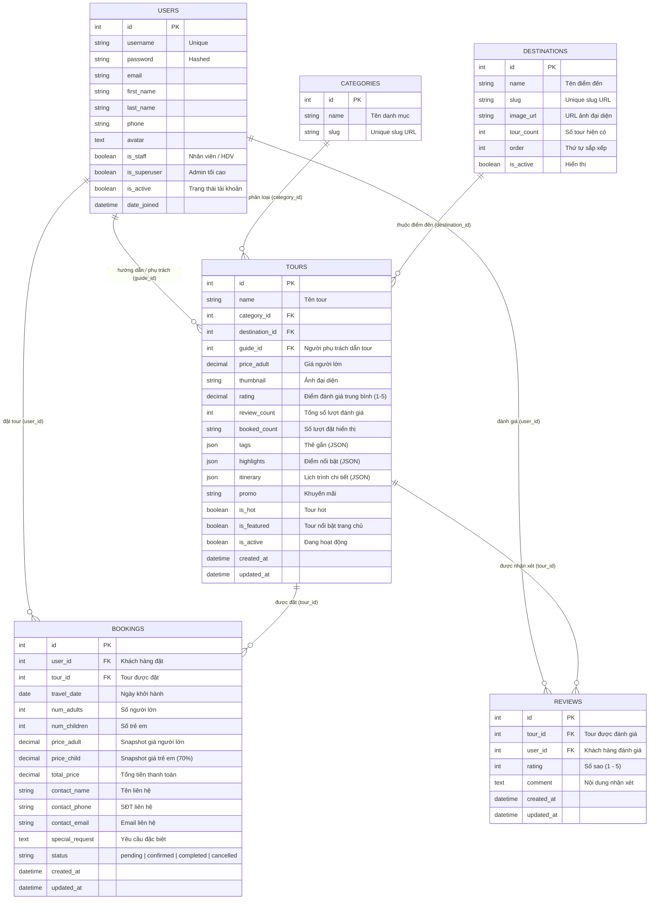

# 🗄️ SƠ ĐỒ CƠ SỞ DỮ LIỆU DỰ ÁN TOURISM (DATABASE SCHEMA)

Tài liệu này tổng hợp toàn bộ các bảng dữ liệu (Models), trường thuộc tính, kiểu dữ liệu, khóa ngoại và mối quan hệ thực thể trong hệ thống website đặt tour du lịch.

---

## 📌 1. Sơ đồ quan hệ thực thể (Entity Relationship Diagram - ERD)

---

## 📋 2. Chi tiết cấu trúc từng bảng dữ liệu

### 1. Bảng `users` (Người dùng & Phân quyền)
- **Model Django:** `backend/accounts/models.py` (Class `User` kế thừa từ `AbstractUser`).
- **Mô tả:** Lưu thông tin tài khoản, đăng nhập, hồ sơ và vai trò phân quyền.

| Tên cột | Kiểu dữ liệu | Ràng buộc | Mô tả |
| :--- | :--- | :--- | :--- |
| `id` | `BigAutoField` | **PRIMARY KEY**, Auto-increment | Khóa chính tự tăng |
| `username` | `VARCHAR(150)` | **UNIQUE**, Not Null | Tên tài khoản đăng nhập |
| `password` | `VARCHAR(128)` | Not Null | Mật khẩu đã băm (PBKDF2/SHA256) |
| `email` | `VARCHAR(254)` | Nullable | Email người dùng |
| `first_name` | `VARCHAR(150)` | Blank | Họ và tên đệm |
| `last_name` | `VARCHAR(150)` | Blank | Tên |
| `phone` | `VARCHAR(20)` | Nullable, Blank | Số điện thoại liên hệ |
| `avatar` | `TEXT` | Nullable, Blank | URL ảnh đại diện hoặc base64 |
| `is_staff` | `BOOLEAN` | Default: `False` | **Nhân viên / Hướng dẫn viên (HDV)** |
| `is_superuser` | `BOOLEAN` | Default: `False` | **Quản trị viên tối cao (Admin)** |
| `is_active` | `BOOLEAN` | Default: `True` | `True` = Hoạt động; `False` = Khóa tài khoản |
| `date_joined` | `TIMESTAMPTZ`| Auto-now-add | Ngày giờ tạo tài khoản |
| `last_login` | `TIMESTAMPTZ`| Nullable | Lần đăng nhập cuối cùng |

> **Quy tắc phân quyền:**
> - **Quản trị viên (Admin):** `is_superuser = True` (toàn quyền hệ thống).
> - **Hướng dẫn viên (HDV/Staff):** `is_staff = True, is_superuser = False` (chỉ xem & quản lý tour mình dẫn, doanh thu tour mình, duyệt đơn tour mình).
> - **Khách hàng (Customer):** `is_staff = False, is_superuser = False`.

---

### 2. Bảng `destinations` (Điểm đến du lịch)
- **Model Django:** `backend/tours/models.py` (Class `Destination`).
- **Mô tả:** Các địa danh du lịch (Đà Nẵng, Phú Quốc, Hạ Long, Sa Pa, Đà Lạt,...).

| Tên cột | Kiểu dữ liệu | Ràng buộc | Mô tả |
| :--- | :--- | :--- | :--- |
| `id` | `BigAutoField` | **PRIMARY KEY**, Auto-increment | Khóa chính |
| `name` | `VARCHAR(200)` | Not Null | Tên địa danh (vd: Đà Nẵng, Phú Quốc) |
| `slug` | `VARCHAR(200)` | **UNIQUE**, Not Null | Định danh đường dẫn URL (vd: `da-nang`) |
| `image_url` | `VARCHAR(500)` | Not Null | URL hình ảnh đại diện điểm đến |
| `tour_count` | `INTEGER UNSIGNED` | Default: `0` | Tổng số tour tại điểm đến (tự động đếm) |
| `is_active` | `BOOLEAN` | Default: `True` | Ẩn/Hiện trên trang chủ |
| `order` | `SMALLINT UNSIGNED`| Default: `0` | Thứ tự hiển thị ưu tiên |

---

### 3. Bảng `categories` (Danh mục tour)
- **Model Django:** `backend/tours/models.py` (Class `Category`).
- **Mô tả:** Phân loại tour (Cáp treo, Tour tham quan, Công viên giải trí, Trải nghiệm biển đảo,...).

| Tên cột | Kiểu dữ liệu | Ràng buộc | Mô tả |
| :--- | :--- | :--- | :--- |
| `id` | `BigAutoField` | **PRIMARY KEY**, Auto-increment | Khóa chính |
| `name` | `VARCHAR(100)` | Not Null | Tên danh mục |
| `slug` | `VARCHAR(100)` | **UNIQUE**, Not Null | Định danh URL (vd: `cap-treo`) |

---

### 4. Bảng `tours` (Thông tin Tour du lịch)
- **Model Django:** `backend/tours/models.py` (Class `Tour`).
- **Mô tả:** Bảng chứa dữ liệu chính của hệ thống, lưu trữ chi tiết tour, giá vé, người phụ trách, điểm nổi bật và lịch trình.

| Tên cột | Kiểu dữ liệu | Ràng buộc | Mô tả |
| :--- | :--- | :--- | :--- |
| `id` | `BigAutoField` | **PRIMARY KEY**, Auto-increment | Khóa chính |
| `name` | `VARCHAR(500)` | Not Null | Tên tour du lịch |
| `category_id` | `BIGINT` | **FOREIGN KEY** ➡️ `categories.id` (`ON DELETE SET NULL`) | Danh mục tour (Nullable) |
| `destination_id`| `BIGINT` | **FOREIGN KEY** ➡️ `destinations.id` (`ON DELETE SET NULL`) | Điểm đến của tour (Nullable) |
| `guide_id` | `BIGINT` | **FOREIGN KEY** ➡️ `users.id` (`ON DELETE SET NULL`) | **Hướng dẫn viên phụ trách dẫn tour** (Nullable) |
| `price_adult` | `DECIMAL(12,0)`| Not Null | Giá vé người lớn (VNĐ) |
| `thumbnail` | `VARCHAR(500)` | Not Null | URL hình ảnh đại diện của tour |
| `rating` | `DECIMAL(3,1)` | Default: `0.0` | Điểm đánh giá trung bình (1.0 – 5.0) |
| `review_count`| `INTEGER UNSIGNED`| Default: `0` | Tổng số lượng đánh giá thực tế |
| `booked_count`| `VARCHAR(20)` | Default: `'0'` | Số lượt đặt hiển thị marketing (vd: 1.2k) |
| `tags` | `JSON` | Default: `[]` | Mảng nhãn (vd: `["Xác nhận tức thời", "Miễn phí huỷ"]`) |
| `highlights` | `JSON` | Default: `[]` | Mảng điểm nổi bật `[{"icon": "🚡", "text": "..."}]` |
| `itinerary` | `JSON` | Default: `[]` | Mảng mốc giờ `[{"time": "08:00", "desc": "..."}]` |
| `promo` | `VARCHAR(200)` | Nullable, Blank | Nhãn ưu đãi (vd: "Giảm 20%") |
| `is_hot` | `BOOLEAN` | Default: `False` | Huy hiệu Tour Hot |
| `is_featured`| `BOOLEAN` | Default: `False` | Hiển thị nổi bật trang chủ |
| `is_active` | `BOOLEAN` | Default: `True` | Trạng thái hiển thị (Đang bán / Tạm ngưng) |
| `created_at` | `TIMESTAMPTZ`| Auto-now-add | Thời gian tạo tour |
| `updated_at` | `TIMESTAMPTZ`| Auto-now | Thời gian cập nhật gần nhất |

---

### 5. Bảng `bookings` (Đơn đặt tour)
- **Model Django:** `backend/bookings/models.py` (Class `Booking`).
- **Mô tả:** Quản lý giao dịch đặt chỗ, người đi, snapshot giá và trạng thái thanh toán.

| Tên cột | Kiểu dữ liệu | Ràng buộc | Mô tả |
| :--- | :--- | :--- | :--- |
| `id` | `BigAutoField` | **PRIMARY KEY**, Auto-increment | Mã đơn đặt (Booking ID) |
| `user_id` | `BIGINT` | **FOREIGN KEY** ➡️ `users.id` (`ON DELETE CASCADE`) | Tài khoản khách hàng đặt tour |
| `tour_id` | `BIGINT` | **FOREIGN KEY** ➡️ `tours.id` (`ON DELETE CASCADE`) | Tour được đặt |
| `travel_date` | `DATE` | Not Null | Ngày khởi hành |
| `num_adults` | `SMALLINT UNSIGNED` | Default: `1` | Số lượng người lớn (tối thiểu 1) |
| `num_children`| `SMALLINT UNSIGNED` | Default: `0` | Số lượng trẻ em |
| `price_adult` | `DECIMAL(12,0)`| Not Null | Snapshot giá người lớn tại thời điểm đặt |
| `price_child` | `DECIMAL(12,0)`| Default: `0` | Snapshot giá trẻ em (70% giá người lớn) |
| `total_price` | `DECIMAL(14,0)`| Not Null | Tổng tiền thanh toán của đơn |
| `contact_name`| `VARCHAR(200)` | Not Null | Tên người nhận liên hệ |
| `contact_phone`| `VARCHAR(20)` | Not Null | Số điện thoại liên hệ |
| `contact_email`| `VARCHAR(254)` | Not Null | Email nhận vé điện tử |
| `special_request`| `TEXT` | Blank, Default: `''` | Ghi chú (ăn chay, dị ứng, p.thức thanh toán) |
| `status` | `VARCHAR(20)` | Default: `'pending'` | Trạng thái: `pending`, `confirmed`, `completed`, `cancelled` |
| `created_at` | `TIMESTAMPTZ`| Auto-now-add | Thời điểm đặt tour |
| `updated_at` | `TIMESTAMPTZ`| Auto-now | Thời điểm cập nhật trạng thái |

> **Quy ước trạng thái đơn hàng (`status`):**
> 1. `pending` (Chờ xác nhận): Khách vừa đặt nhưng chưa thanh toán. Chưa tính vào doanh thu.
> 2. `confirmed` (Đã xác nhận): Khách đã quét VietQR / thanh toán thành công. **Tự động cộng vào Doanh thu**.
> 3. `completed` (Hoàn thành): Chuyến đi đã kết thúc. **Mở khóa quyền đánh giá Review**. Khóa không cho hủy.
> 4. `cancelled` (Đã huỷ): Khách hoặc Admin hủy đơn. Tiền không được tính vào doanh thu.

---

### 6. Bảng `reviews` (Đánh giá & Nhận xét)
- **Model Django:** `backend/reviews/models.py` (Class `Review`).
- **Mô tả:** Đánh giá chất lượng dịch vụ của khách hàng sau khi đi tour.

| Tên cột | Kiểu dữ liệu | Ràng buộc | Mô tả |
| :--- | :--- | :--- | :--- |
| `id` | `BigAutoField` | **PRIMARY KEY**, Auto-increment | Khóa chính |
| `tour_id` | `BIGINT` | **FOREIGN KEY** ➡️ `tours.id` (`ON DELETE CASCADE`) | Tour được nhận xét |
| `user_id` | `BIGINT` | **FOREIGN KEY** ➡️ `users.id` (`ON DELETE CASCADE`) | Khách hàng đánh giá |
| `rating` | `SMALLINT UNSIGNED` | Check: `1 <= rating <= 5`, Default: `5` | Điểm đánh giá số sao (1 đến 5 sao) |
| `comment` | `TEXT` | Not Null, Min 5 ký tự | Nội dung cảm nhận của khách |
| `created_at` | `TIMESTAMPTZ`| Auto-now-add | Ngày gửi đánh giá |
| `updated_at` | `TIMESTAMPTZ`| Auto-now | Ngày chỉnh sửa |

> **Ràng buộc đặc biệt của bảng `reviews`:**
> - Ràng buộc `UNIQUE(tour_id, user_id)`: Mỗi khách hàng chỉ được đánh giá duy nhất **1 lần cho mỗi tour**.
> - Khách chỉ được đánh giá khi đơn đặt tour đã chuyển sang trạng thái `completed` (Đã hoàn thành chuyến đi).
> - Khi một bản ghi trong bảng này được tạo hoặc xóa, Database tự động kích hoạt tính lại `rating` và `review_count` trên bảng `tours`.

---

## 📊 3. Bảng tổng kết số lượng bản ghi & quy mô cơ sở dữ liệu hiện tại

| STT | Tên bảng (Table) | App phụ trách | Mục đích | Số lượng bản ghi hiện tại |
| :---: | :--- | :--- | :--- | :---: |
| **1** | `users` | `accounts` | Quản lý tài khoản (Admin, HDV, Khách hàng) | 8+ tài khoản |
| **2** | `destinations` | `tours` | Địa danh du lịch các tỉnh thành | 133 điểm đến |
| **3** | `categories` | `tours` | Nhóm danh mục dịch vụ tour | 6 danh mục |
| **4** | `tours` | `tours` | Thông tin chi tiết các tour du lịch | **311 tour** |
| **5** | `bookings` | `bookings` | Đơn đặt tour và lịch sử thanh toán | 15+ đơn |
| **6** | `reviews` | `reviews` | Đánh giá sao và nhận xét thực tế | **61 đánh giá** |

---

*Tài liệu này được tạo tự động để phục vụ báo cáo tiến độ đồ án tốt nghiệp.*
